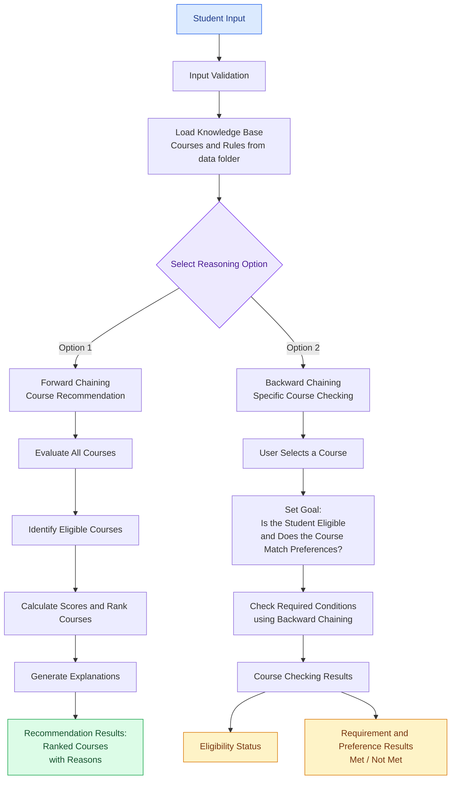

# ainl3001-team-project

# Intelligent Course Recommendation System

## Overview
A rule-based system that recommends a course to a a student. The student enters their credits, passed subjects, favourite subject and career goal. The systems
1. Recommends eligible courses and ranks them based on student facts [forward chaining]
2. Explains what student needs to meet fir a specific course [backward chaining]

Rules live in `data/courses.json` separate from code so courses and scoring can change without editing Python.

## AIMA Problem Formulation
Define the problem -> then solve with general methods from problem definition.
System is knowledge-based agent uses students facts by keyboard input, reasons over a rule-based knowledge base and then displays recommendations with reasons or explanations

|Component | Defintion in realtion to project|
| --- | --- |
| **State** | Set of facts known so far. Only course relevant facts. |
| **Initial state** | Facts from students details (`credits`, `passed_subjects`, `fav_subject`, `carrer_goal`). |
| **Actions** | Apply any rule whose conditions are all present in current state. |
| **Transition model** | The rule conclusion is added to the state. Facts aren't removed. |odel** | The rule's conclusion is added to the state. Facts are never removed. |
| **Goal test** | *Forward chaining:* no new facts can be found, so every course has a result. *Backward chaining:* `eligible<course_name>` is proven for specific course. |
| **Path cost** | Each rule application is cost 1. We don't minimise cost, triggered preference rules add to score used for ranking. |

### State space
It is a graph where nodes are sets of facts and edges are rule applications. Forward chaining searches from intial facts to goal whereas backward chaining searches from goal to the known facts.

| Part of AIMA design | Where it is in project |
| --- | --- |
| Problem defination (courses, hard requirements, soft preferences, rules) | `'data/'` JSON files loaded by `knowledge_base.py` |
| Input handling and validation | `student_input.py` |
| General method: forward chaining, ranking, scoring | `reasoning_engine.py` |
| General method: backward chaining and course check | `backward_chaining.py` |
| User interface | `main.py` |

Rules live in file and not code theres same engine works for multiple courses files if they follow same structure.

## Install
Requires Python 3.10+

`cd ainl3001-team-project`

`pip install -r requirements.txt`

## How to run
`python src/main.py`

`pytin -m pytest -v`

In program choose:
1. Recommed Course: enter facts to get ranked courses with explaination.
2. Check Course: enter facts and course to see what you still need to meet.

## Architecture
```
ainl3001-team-project

|-- data/
|   |-- course.json [course data: hard & soft requirements]
|   |-- rules.json [rule definitions]
|   |-- students.json [sample students for tests]

|-- src/
|   |-- knowledge_base.py [loads and validaets data into knowledge base]
|   |-- reasoning_engine.py [forward chaining, scoring and ranking]
|   |-- backward_chaining.py [goal-driven check one course and outputs unment requirements]
|   |-- main.py [menus, input validation and output]

|-- tests/
|   |-- loader_test.py [unit tests for load_courses function]

|-- proposal/
|   |-- proposal.md
|   |-- image.png

|-- docs/
|-- presentation/
|-- assets/
|-- requirements/
|-- README.md
```

## Pipeline



## Contributions
**Lok Ching Tam:** all rules loader, specific course rule loader, forward-chaining, scoring, ranking, reasons, engine tests

**Amy Webb:** course.json + loader, KB tests, README sections, AIMA formulation, backward-chaing

**Karla Satrapová:** input validation, explanation, output layer, sample students data, end-to-end tests
