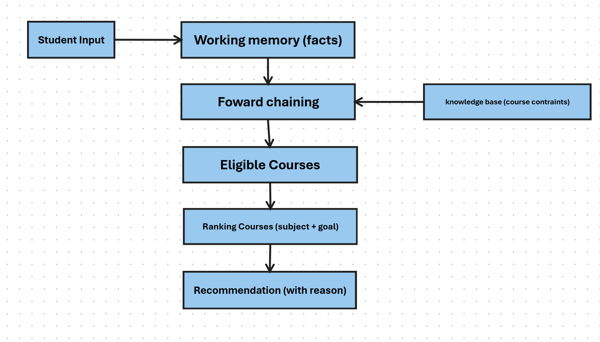

# Team Information
**Group Name:** Group 1

**Student Name/Numbers:** (Amy Webb, C24423456), (Karla Satrapová, C24744861), (Lok Ching Tam, C24385243)

**GitHub Usernames:** AmyWebb16, Karla Satrapova, lokChingt

# Problem Description
**Topic Name:** Intelligent Course Recommedation System

**Description:** Uses a number of facts based on a student to determine what course they should take. They have to meet contraints of course as well.
    
    e.g. {name=John, credits=80, passed_math=True, passed_science=True, fav_subject=Computing, career_goal=software} -> Computer Science

# AI Approach
Core Techinque is **Rule-Based Reasoning**. The system has set of course requirements contained as if-then rules in a knowledge base and thean applies facts about student.

**Forward Chaining:** used to check student's eligiblity for the course 

    e.g. If credits > 40 and passed_math=True Then eligible(Computer Science)

**Rule-based Scoring:** after filtering eligible course use students preferences as scores +2 if matches with their fav_subject and +1 if it meets their carrer goal.

# System Design
System is a modular pipeline. Rules live in a file separate to main code block, so more courses can be added without changing code.

**System Flow Diagram:**

**Input:** reads students facts validate them to ensure right data type.

**Knowledge Base:** has 10 courses with each requirement (credit score and passed subjects) and soft preferences such as favourite subject and carrer goal.

**Forward Chaining:** Checks course requirements against student facts and returns list of eligible courses.

**Ranking Courses:** Scores each eligible course and finds best result.

**Explanantion:** print short reason for eligible course and ineligible course

**Output layer:** Print best course at top and list of other courses with either "eligible" or "not elgible".

**Testing:** use sample set of students with boundary values of where there is no preffered or eligible course.

# Planned Contributions
**Amy Webb:** Search and planning

**Karla Satrapová:** Reasoning and testing

**Lok Ching Tam:** Knowledge representation
