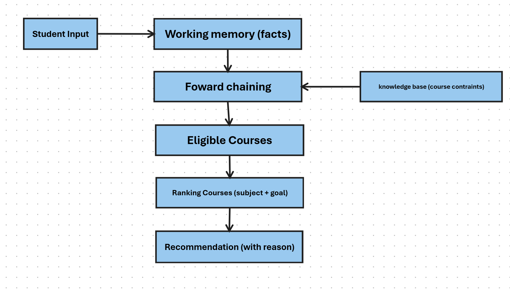

# Team Information
**Group Name:** Group 1

**Student Name/Numbers:** (Amy Webb, C24423456), (Karla Satrapová, C24744861), (Lok Ching Tam, C24385243)

**GitHub Usernames:** AmyWebb16, Karla Satrapova, lokChingt

# Problem Description
**Topic Name:** Intelligent Course Recommedation System

**Why is course selection hard:** Course selection is not just looking at one number.All courses have requirements such as credits needed and specific subjects based on curse that excludes some students. There are also the students personal goals that also effect a decidion between 2 or more courses that may interfer with students wants (e.g. Student wants Maths but doesn't meet credits needed). Students get a yes/no answer with no reason of why or why not they got a course.

**Problem solving:** Using a students facts the system

1. checks if student eligbility of courses.
2. checks conflicts between requirements and preferences.
3. rank eligbile courses.
4. exaplain reasoning for decision
    
    e.g. {name=John, credits=80, passed_math=True, passed_science=True, fav_subject=Computing, career_goal=software} -> Computer Science

# AI Approach
Core Techinque is **Knowledge-Based Reasoning**. 

**Forward Chaining:** uses facts from student facts and rules from course file.
e.g. credits >= 40 AND passed_math -> eligible(Computer Science), the eligible(c) And subject_match(c) And career_match(c) -> strongly_recomend(c). It returns a result and a reason for each course.

**Rule-based Scoring:** rules are the main factor of decideing course but ties are broken with prefernces.

# Knowledge Base
A JSON file loaded at start of runtime and rules can change without touching code:

- Course facts: has credits needed, required subjects and perferences.
- Elgibilty rules: are hard contraints such as Computer Science >= 40 credits and you need to pass maths.

# System Design
Input -> KB loader -> Forward chaining -> ranking -> explanation -> output

**System Flow Diagram:**

**Input:** reads students facts validate them to ensure right data type.

**Forward Chaining:** Checks course requirements against student facts and returns list of eligible courses.

**Ranking Courses:** Scores each eligible course and finds best result.

**Explanantion:** print short reason for eligible course and ineligible course

**Output layer:** Print best course at top and list of other courses with either "eligible" or "not elgible".

**Testing:** unit test for KB and engine and boundary tests, no eligible course and conflicting perferences.

# Planned Contributions
**Amy Webb:** Knowledge base and integration: courses.json + loader, KB tests, main.py, general README sections (overview, install, architecture, how to run, contributions), AIMA problem formulation, backward chaining

**Karla Satrapová:** Input validation, explanation (formatting engine reasons into sentences), output layer, sample students, end-to-end/boundary tests, example outputs in README.

**Lok Ching Tam:** Reasoning: forward chaining returning a result and reason for every course, scoring/ranking/tie-break, engine unit tests, README reasoning section.

